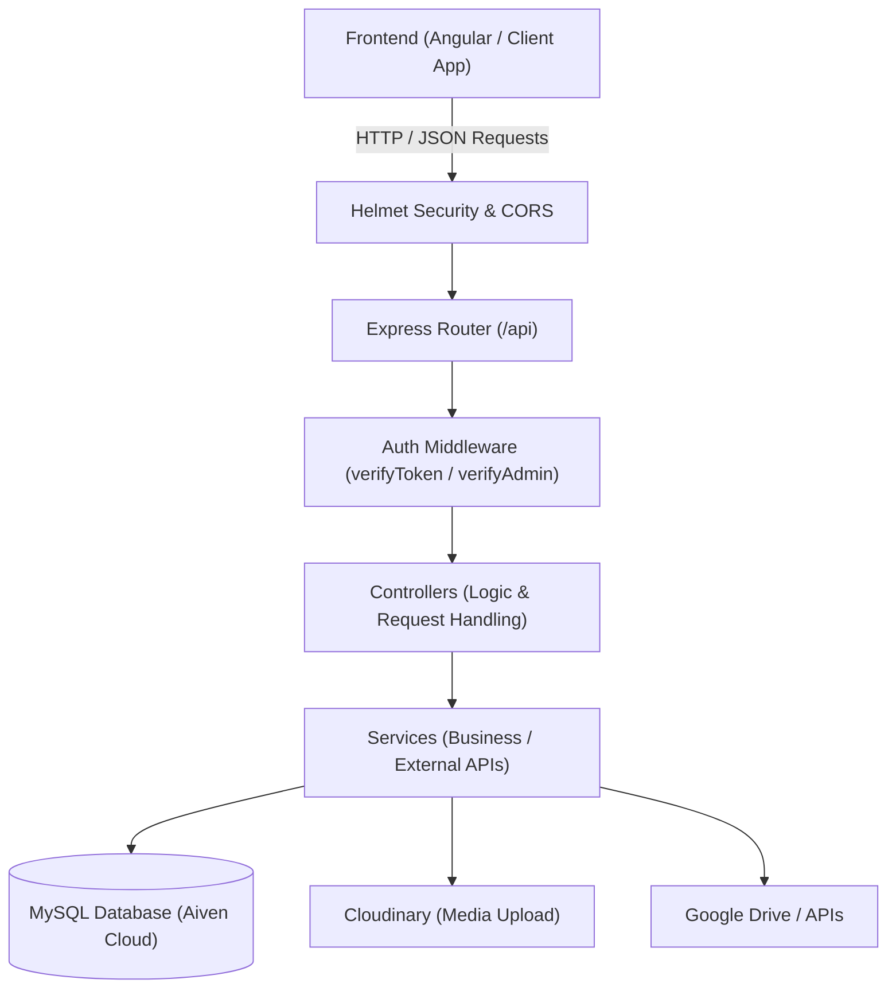

# Backend-School: ระบบประเมินและสถิติ (Backend API)

API Service สำหรับระบบประเมินผลการเรียน, จัดการคะแนน, ข้อมูลนักเรียน, และการบริหารจัดการสำหรับผู้ดูแลระบบ พัฒนาด้วย **Node.js, Express, TypeScript** และเชื่อมต่อฐานข้อมูล **MySQL** (รองรับ SSL บน Cloud เช่น Aiven Cloud) และ Deploy บน **Render**

---

## สารบัญ

1. [ภาพรวมสถาปัตยกรรม (Architecture Overview)](#ภาพรวมสถาปัตยกรรม-architecture-overview)
2. [เทคโนโลยีที่ใช้ (Tech Stack)](#เทคโนโลยีที่ใช้-tech-stack)
3. [สิ่งที่ต้องเตรียมล่วงหน้า (Prerequisites)](#สิ่งที่ต้องเตรียมล่วงหน้า-prerequisites)
4. [ขั้นตอนการติดตั้งและรันโปรเจกต์ (Installation & Running)](#ขั้นตอนการติดตั้งและรันโปรเจกต์)
5. [การตั้งค่า Environment Variables (.env)](#การตั้งค่า-environment-variables-env)
6. [โครงสร้างโปรเจกต์ (Folder Structure)](#โครงสร้างโปรเจกต์-folder-structure)
7. [หมวดหมู่ API Endpoints (API Routes)](#หมวดหมู่-api-endpoints-api-routes)
8. [ระบบความปลอดภัยและการยืนยันตัวตน (Auth & Security)](#ระบบความปลอดภัยและการยืนยันตัวตน-auth--security)
9. [การทำงานกับไฟล์และ Third-Party Services](#การทำงานกับไฟล์และ-third-party-services)
10. [แนวทางการพัฒนาต่อและการ Deploy (Deployment & Handover Notes)](#แนวทางการพัฒนาต่อและการ-deploy)

---

## ภาพรวมสถาปัตยกรรม (Architecture Overview)

ระบบใช้สถาปัตยกรรมแบบ **Layered Architecture (Routes -> Middleware -> Controllers -> Services -> Database)**:



---

## เทคโนโลยีที่ใช้ (Tech Stack)

| ส่วนประกอบ                   | เทคโนโลยี / Library                                                    | หน้าที่                                                   |
| ---------------------------- | ---------------------------------------------------------------------- | --------------------------------------------------------- |
| **Runtime & Language**       | Node.js (v20+), TypeScript (`tsx`, `ts-node`)                          | สภาพแวดล้อมและภาษาหลัก                                    |
| **Web Framework**            | Express 5.x                                                            | จัดการ Routing และ REST API                               |
| **Database**                 | MySQL2 (Connection Pool with SSL)                                      | ฐานข้อมูลหลัก (Aiven Cloud)                               |
| **Security**                 | `helmet`, `cors`, `jsonwebtoken` (JWT), `bcrypt`, `express-rate-limit` | ป้องกันการโจมตี, เข้ารหัสรหัสผ่าน, และตรวจสิทธิ์          |
| **File Handling**            | `multer`, `streamifier`                                                | รับไฟล์อัปโหลดและส่งต่อไปยัง Cloud Storage                |
| **Third-Party Integrations** | `cloudinary`, `googleapis`                                             | ที่จัดเก็บรูปภาพ และเชื่อมต่อ Google Drive / Google APIs  |

---

## สิ่งที่ต้องเตรียมล่วงหน้า (Prerequisites)

- **Node.js**: เวอร์ชัน 20.x ขึ้นไป (แนะนำ LTS)
- **NPM**: v10+
- **MySQL Database**: สามารถใช้ MySQL Server บนเครื่อง หรือ Cloud MySQL (เช่น Aiven Cloud)

---

## ขั้นตอนการติดตั้งและรันโปรเจกต์ (Installation & Running)

### 1. ติดตั้ง Dependencies

```bash
npm install
```

### 2. ตั้งค่าไฟล์สภาพแวดล้อม (`.env`)

คัดลอกไฟล์ต้นแบบ `.env.example` มาเป็น `.env`:

```bash
cp .env.example .env
```

จากนั้นเปิดไฟล์ `.env` แล้วแก้ไขข้อมูลการเชื่อมต่อฐานข้อมูลและ Secret Keys ให้ตรงกับระบบจริงของคุณ

### 3. นำเข้าโครงสร้างฐานข้อมูล (Database Setup)

หากคุณติดตั้งฐานข้อมูล MySQL ใหม่ (Local หรือ Cloud) และยังไม่มีตาราง สามารถนำเข้าโครงสร้างตารางเริ่มต้นได้จากไฟล์ `database/schema.sql`:

- **ผ่านคำสั่ง Terminal (CLI)**:
  ```bash
  mysql -u <db_user> -p <db_name> < database/schema.sql
  ```
- **หรือผ่านโปรแกรม GUI** (เช่น DBeaver, phpMyAdmin, MySQL Workbench, Navicat):
  1. เปิดไฟล์ `database/schema.sql`
  2. สั่ง Execute / Run ทั้งหมดในฐานข้อมูลที่คุณสร้างไว้

### 4. รันโปรเจกต์ในโหมด Development

ใช้คำสั่งผ่าน `npm scripts` (ทำงานผ่าน `tsx watch` เพื่อ Hot-reload อัตโนมัติเมื่อมีการแก้ไขโค้ด):

```bash
npm run dev
```

หรือรันคำสั่งตรง:

```bash
npx tsx watch server.ts
```

เมื่อสำเร็จ เซิร์ฟเวอร์จะแสดงข้อความ:

```text
Database connected successfully.
Server is running on port 3000
```

---

## การตั้งค่า Environment Variables (`.env`)

| ตัวแปร         |  ความจำเป็น   | คำอธิบาย                                      | ตัวอย่างค่า                  |
| -------------- | :-----------: | --------------------------------------------- | ---------------------------- |
| `PORT`         |   🟡 เสริม    | พอร์ตที่ Express ฟังคำขอ (ค่าเริ่มต้น: 3000)  | `3000` หรือ `5000`           |
| `DB_HOST`      |   🔴 จำเป็น   | Hostname ของฐานข้อมูล MySQL                   | `mysql-xxxxx.aivencloud.com` |
| `DB_PORT`      |   🔴 จำเป็น   | Port ของฐานข้อมูล MySQL                       | `22478` หรือ `3306`          |
| `DB_USER`      |   🔴 จำเป็น   | Username ผู้ใช้งานฐานข้อมูล                   | `avnadmin` หรือ `root`       |
| `DB_PASSWORD`  |   🔴 จำเป็น   | รหัสผ่านฐานข้อมูล                             | `********`                   |
| `DB_NAME`      |   🔴 จำเป็น   | ชื่อฐานข้อมูลที่ใช้งาน                        | `defaultdb`                  |
| `DB_CA_CERT`   | 🟡 ถ้ามี SSL  | Certificate ของ Database กรณีใช้ SSL Cloud    | Base64 string                |
| `JWT_SECRET`   |   🔴 จำเป็น   | Secret Key สำหรับเซ็นและตรวจสอบ JWT Token     | `your-secret-token-key`      |
| `CLOUDINARY_*` | 🟡 สำหรับรูป  | Cloud Name, API Key, Secret สำหรับเก็บรูป     | ดึงจาก Cloudinary Dashboard  |
| `GOOGLE_*`     | 🟡 Google API | ข้อมูล Service Account และ Folder ID ใน Drive | `config/google-key.json`     |

---

## โครงสร้างโปรเจกต์ (Folder Structure)

```text
Backend-School/
├── config/                  # ตั้งค่าเชื่อมต่อบริการภายนอก (Cloudinary, Google Drive)
├── controller/              # จัดการ Request/Response และประมวลผลตามฟังก์ชันงาน
├── database/                # โครงสร้างตารางฐานข้อมูล MySQL (schema.sql)
├── middleware/              # ตัวกรอง Request เช่น ตรวจสอบ JWT Token (auth.middleware.ts)
├── routes/                  # กำหนด Endpoint URL และส่งต่อไปยัง Controller ที่เกี่ยวข้อง
├── services/                # Business Logic และการเชื่อมต่อฟังก์ชันเฉพาะทาง
├── uploads/                 # ที่เก็บไฟล์อัปโหลดชั่วคราว
├── utils/                   # ฟังก์ชัน Helper Utility ที่ใช้ร่วมกัน
├── app.ts                   # ตั้งค่า Express App (CORS, Helmet, Body Parser, Routes รวม)
├── dbconn.ts                # การเชื่อมต่อ MySQL Connection Pool (Aiven Cloud SSL)
├── server.ts                # Entry Point สำหรับเริ่มต้นเซิร์ฟเวอร์และฟังพอร์ต
├── package.json             # กำหนด Dependencies และคำสั่งรันระบบ
└── tsconfig.json            # การตั้งค่า TypeScript Compiler
```

---

### รายละเอียดการทำงานของโฟลเดอร์หลัก

- **`routes/`**: กำหนด URL path ต่างๆ ของ API เช่น `/api/scores`, `/api/student` และทำหน้าที่ส่งคำขอต่อไปยัง Controller ที่รับผิดชอบ
- **`middleware/`**: ตัวกรองคำขอก่อนถึง Controller มี `auth.middleware.ts` สำหรับตรวจสิทธิ์ JWT:
  - `verifyToken`: เช็คว่ามี Token แนบมาและถูกต้องหรือไม่ (สำหรับนักเรียนและทั่วไป)
  - `verifyAdmin`: เช็คว่าผู้ส่งคำขอมีบทบาทเป็น Admin หรือ Super Admin เท่านั้น
- **`controller/`**: รับ Parameter, Body หรือ Query จากหน้าบ้าน ตรวจสอบความถูกต้อง แล้วเรียกใช้คำสั่ง SQL หรือ Service เพื่อทำงานกับฐานข้อมูล จากนั้นส่งข้อมูลกลับไปในรูปแบบ JSON
- **`dbconn.ts`**: จัดการการเชื่อมต่อฐานข้อมูล MySQL บน Aiven Cloud โดยสร้างเป็น Connection Pool รองรับการเชื่อมต่อพร้อมกัน และตั้งค่า SSL (`rejectUnauthorized: false`) เพื่อความปลอดภัย
- **`app.ts` & `server.ts`**:
  - `app.ts` รวม Middleware ความปลอดภัย เช่น `helmet` (ป้องกันช่องโหว่ HTTP Header), `cors` (อนุญาตการเรียกข้ามโดเมน), และตั้งค่า Serve ไฟล์ Static จากโฟลเดอร์ `/uploads`
  - `server.ts` ทำการทดสอบต่อฐานข้อมูลก่อน แล้วค่อยสั่ง `app.listen(PORT)` เพื่อเปิดรับการเชื่อมต่อ

---

### รายละเอียด Controllers ใน `controller/`

| Controller                      | หน้าที่และความรับผิดชอบ                                                                                |
| ------------------------------- | ------------------------------------------------------------------------------------------------------ |
| **`authController.ts`**         | ระบบยืนยันตัวตน (เข้าสู่ระบบนักเรียนด้วยอีเมล / Google OAuth, เข้าสู่ระบบแอดมิน, ลงทะเบียนใหม่)       |
| **`studentController.ts`**      | จัดการข้อมูลทะเบียนนักเรียน (ค้นหา, เพิ่ม, แก้ไข, จัดเรียงลำดับ และลบข้อมูลนักเรียน)                 |
| **`score.controller.ts`**       | จัดการคะแนนและผลการเรียน (บันทึกคะแนนสอบ, คำนวณตัดเกรด, จัดอันดับ Ranking, เตรียมข้อมูลออก Transcript) |
| **`course.controller.ts`**      | จัดการข้อมูลหลักสูตรและรุ่นการศึกษา                                                                    |
| **`subject.controller.ts`**     | จัดการรายวิชาและหน่วยการเรียนรู้ภายใต้แต่ละหลักสูตร                                                    |
| **`evaluation.controller.ts`**  | จัดการแบบประเมินและบันทึกผลการทำแบบประเมิน                                                             |
| **`summary.controller.ts`**           | ประมวลผลและสรุปข้อมูลสถิติภาพรวมของการฝึกอบรม                                                          |
| **`executive-summary.controller.ts`** | สร้างบทสรุปผู้บริหารและแผนปฏิบัติการอัตโนมัติจากสถิติคะแนน (Executive Summary & Action Plan)          |
| **`profileEdit.controller.ts`**       | จัดการคำขอแก้ไขข้อมูลส่วนตัวของนักเรียน และระบบอนุมัติคำขอสำหรับแอดมิน                                 |
| **`admin-user.controller.ts`**  | จัดการผู้ดูแลระบบ (เพิ่ม, แก้ไข, ลบ บัญชีแอดมิน)                                                       |
| **`admin-log.controller.ts`**   | บันทึกประวัติการกระทำของแอดมินในระบบ (Audit Trail) เพื่อความปลอดภัยและการตรวจสอบย้อนหลัง               |
| **`news.controller.ts`**        | จัดการข่าวสารและประกาศประชาสัมพันธ์                                                                    |
| **`dropdown.controller.ts`**    | ดึงข้อมูลตัวเลือกสำหรับ Dropdown Form (เช่น รายชื่อรุ่น, รายชื่อวิชา)                                  |

---

## หมวดหมู่ API Endpoints (API Routes)

ทุก Endpoint ขึ้นต้นด้วย Prefix: `/api`

### 1. ระบบยืนยันตัวตน (Authentication) - `routes/auth.route.ts`

- `POST /api/auth/login` - เข้าสู่ระบบของนักเรียน (ด้วยอีเมล)
- `POST /api/auth/admin/login` - เข้าสู่ระบบของผู้ดูแลระบบ (Admin)
- `POST /api/auth/register` - ลงทะเบียนนักเรียนใหม่
- `POST /api/auth/google` - ยืนยันตัวตนผ่าน Google OAuth Token
- `GET /api/auth/verify` - ตรวจสอบความถูกต้องของ Token ปัจจุบัน

### 2. ข้อมูลนักเรียน (Student) - `routes/student.route.ts`

- `GET /api/students` - ดึงรายชื่อนักเรียน (กรองตามรุ่น/หลักสูตรได้)
- `POST /api/students/add` - เพิ่มข้อมูลนักเรียนรายคน
- `PUT /api/students/:id` - อัปเดตข้อมูลนักเรียน
- `DELETE /api/students/:id` - ลบข้อมูลนักเรียน

### 3. หลักสูตรและวิชา (Course & Subjects) - `routes/course.route.ts`

- `GET /api/courses` - ดึงรายการหลักสูตรทั้งหมด
- `POST /api/courses` - สร้างหลักสูตรใหม่
- `GET /api/courses/:id/subjects` - ดึงวิชาภายใต้หลักสูตร

### 4. คะแนนและการตัดเกรด (Scores & Rankings) - `routes/score.route.ts`

- `GET /api/scores/student/:studentId` - ผลคะแนนรายบุคคล
- `POST /api/scores/save` - บันทึกคะแนน
- `GET /api/scores/ranking` - ดึงอันดับนักเรียนตามคะแนนเฉลี่ย
- `GET /api/scores/transcript/:studentId` - ข้อมูลสำหรับออกใบรายงานผลการเรียน (Transcript)

### 5. การประเมินผล (Evaluations) - `routes/evaluation.route.ts`

- `GET /api/evaluations/forms` - ดึงแบบฟอร์มการประเมิน
- `POST /api/evaluations/submit` - ส่งแบบประเมิน
- `GET /api/evaluations/summary` - ดึงสรุปผลการประเมินภาพรวม

### 6. ผู้ดูแลระบบและบันทึกประวัติ (Admin Management)

- `routes/admin-user.route.ts` - จัดการบัญชีแอดมินและการกำหนดบทบาท
- `routes/admin-log.route.ts` - ตรวจสอบ Log การกระทำต่างๆ ในระบบ
- `routes/profileEdit.route.ts` - อนุมัติ/ปฏิเสธคำขอแก้ไขข้อมูลของนักเรียน

---

## ระบบความปลอดภัยและการยืนยันตัวตน (Auth & Security)

1. **JSON Web Token (JWT)**:
   - ออก Token เมื่อเข้าสู่ระบบสำเร็จ โดยแยก Payload ระหว่างนักเรียน และแอดมิน
   - การเรียกใช้งาน API ที่ต้องการสิทธิ์ ต้องแนบ Header:
     ```http
     Authorization: Bearer <your_jwt_token>
     ```
2. **Middleware ป้องกัน Route**:
   - `verifyToken`: ตรวจสอบความถูกต้องของ Token ทั่วไป
   - `verifyAdmin`: ตรวจสอบว่าผู้ถือ Token มีสิทธิ์เป็น Admin หรือ Super Admin เท่านั้น
3. **Helmet & Cross-Origin**:
   - มีการใช้ `helmet` ป้องกัน HTTP Header ช่องโหว่ยอดนิยม
   - กำหนด `crossOriginResourcePolicy: { policy: "cross-origin" }` เพื่อให้ Frontend ดึงรูปภาพจาก `/uploads` ข้ามโดเมนได้
4. **Reverse Proxy & Rate Limiting**:
   - มีการตั้งค่า `app.set("trust proxy", 1);` เพื่อให้การตรวจจับ IP และ Rate Limiter ทำงานได้ถูกต้องเมื่อรันอยู่หลัง Reverse Proxy (เช่น Render, Cloudflare)

---

## การทำงานกับไฟล์และ Third-Party Services

- **รูปภาพและมีเดีย**: อัปโหลดผ่าน `multer` และส่งขึ้น **Cloudinary** เพื่อลดภาระพื้นที่จัดเก็บบน Server
- **Google Service Account**: ใช้ไฟล์ `config/google-key.json` สำหรับการติดต่อกับ Google Drive และ Google OAuth เพื่อจัดการเอกสารและยืนยันตัวตน

---

## แนวทางการพัฒนาต่อและการ Deploy (Handover Notes)

### 1. การ Deploy บน Render

- ปัจจุบัน Production API อยู่ที่: `https://backend-school-7x2e.onrender.com/api`
- **Build Command**: `npm install`
- **Start Command**: `npx tsx server.ts` (หรือคอมไพล์ด้วย `tsc && node dist/server.js`)
- **Environment Variables**: ต้องนำตัวแปรทั้งหมดใน `.env` ไปกรอกลงใน Environment Settings ของ Render ให้ครบถ้วน

### 2. สิ่งที่ควรระวังสำหรับผู้พัฒนาต่อ (Gotchas & Best Practices)

- **อย่าลบ `config/google-key.json`**: ไฟล์นี้จำเป็นต่อการทำงานของ Google APIs (ตรวจเช็คการตั้งค่าใน `.gitignore` เสมอ)
- **SSL Database**: การต่อ MySQL บน Aiven Cloud จำเป็นต้องเปิด SSL (`rejectUnauthorized: false` ใน `dbconn.ts`)
- **การเพิ่ม Route ใหม่**:
  1. สร้างไฟล์ Route ใน `routes/your-name.route.ts`
  2. สร้าง Logic ใน `controller/your-name.controller.ts`
  3. นำมา import และผูกที่ `app.ts` ด้วย `app.use("/api", yourRoute);`
